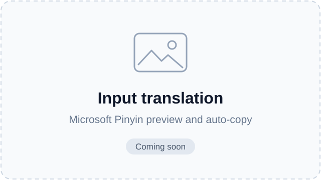
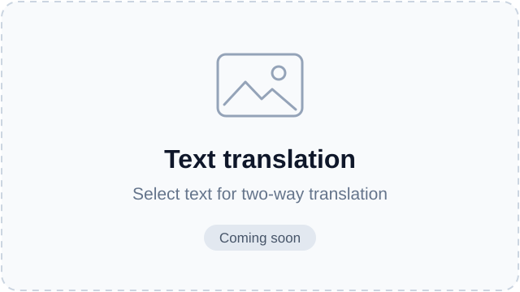
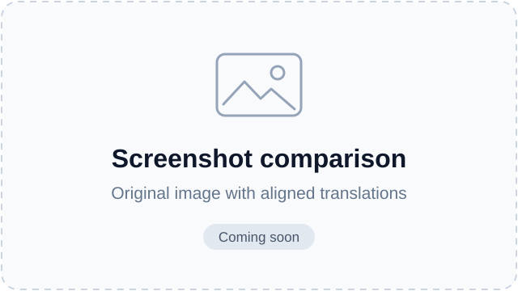

# PinyinTranslate

[简体中文](README.md) | **English**

A Windows AI translator that works alongside Microsoft Pinyin, with **input translation, two-way text translation, and screenshot comparison**.

**[Download the latest release](https://github.com/ihhhhhooo/PinyinTranslate/releases/latest)** · [Demo](#demo) · [Changelog](RELEASE-NOTES.md)

For **Windows 11 x64**. Bring your own **DeepSeek API key**; the .NET runtime is included. The app interface is currently in Chinese.

## Features

| Feature | Default shortcut | How it works |
| --- | --- | --- |
| Input translation | `Ctrl+Alt+T` | Translate the first Microsoft Pinyin candidate and copy the result. Wait for “已复制” (Copied), press `Esc` to cancel Pinyin, then `Ctrl+V` to paste. |
| Two-way text translation | `Ctrl+Alt+D` | Select text to translate between your chosen languages. If automatic selection reading fails, select and press `Ctrl+C`; terminals also support `Ctrl+Shift+C`. Click a result to copy it. |
| Screenshot translation | `Ctrl+Alt+S` | Capture a region and compare the original image with the original text and translation, paragraph by paragraph. |

Languages: Chinese (Simplified/Traditional), English, Japanese, Korean, French, German, Spanish, Portuguese, Russian, and Vietnamese. Set separate targets for input and screenshots, or choose any two languages for text translation.

Also includes in-app updates, usage statistics, and multiple themes.

## Demo

<!-- Video slot: replace this placeholder with your video link or a clickable cover. -->

<!-- Screenshot slots: replace these placeholders with real screenshots. -->
| Input translation | Two-way text translation | Screenshot comparison |
| --- | --- | --- |
|  |  |  |

Demo media is coming soon. See the [media instructions](docs/media/README.md) for replacing these placeholders.

## Quick start

1. Download `Setup.exe` from [Releases](https://github.com/ihhhhhooo/PinyinTranslate/releases/latest) and run it. Alternatively, extract `Portable.zip`.
2. Open **设置** (Settings), enter your DeepSeek API key, and save it.
3. Choose languages next to each feature's shortcut, click **保存设置** (Save settings), then enable a feature or use its shortcut above.

**To update:** 设置 → 软件更新 → 检查更新 → 下载更新 → 更新并重启 (Settings → Software update → Check for updates → Download → Update and restart).

## Notes

- Translation content is sent to DeepSeek and billed to your API account. In-app cost figures are estimates.
- Input translation replaces clipboard text. While text translation is enabled, manually copying a fresh selection also requests translation; turning the mode off stops both paths.
- Automatic reading depends on the target app. Use copy-to-translate or screenshots when needed; automatic compatibility with every app is not guaranteed.

[Detailed guide](docs/guide.md) · [Languages](reports/multilingual.md) · [Pricing](reports/pricing.md) · [Updates](reports/updates.md) (these guides are in Chinese) · [Report an issue](https://github.com/ihhhhhooo/PinyinTranslate/issues) · [MIT License](LICENSE)
